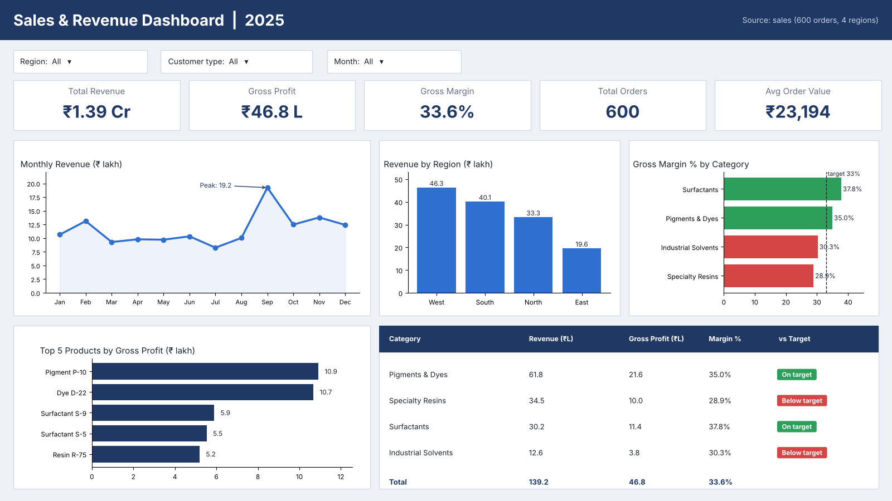

# Sales & Revenue Financial Analysis

Analysis of sales and revenue data to track revenue, performance by product/region and key financial trends, using Excel, SQL and a Power BI dashboard layout.

*Note: The dataset is synthetic, created for portfolio purposes.*

## Dashboard

## Tools
- Excel: data cleaning, pivot tables, financial analysis
- SQL: revenue and sales analysis queries
- Power BI: dashboard layout design

## Files
- `sales_data.csv`: sales data
- `sales_revenue_queries.sql`: SQL queries
- `Sales_Revenue_Financial_Analysis.xlsx`: Excel analysis

## Key Findings
- Total revenue: (dashboard varun liha)
- Top product/region: (liha)
- Lowest performing product/region: (liha)
- Ek trend (mahinyanusar vadh/ghat): (liha)
